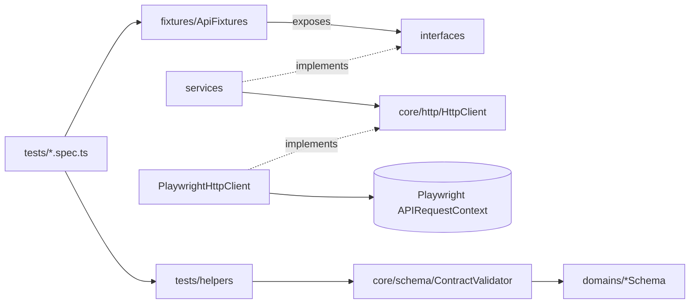

# financial-lab-testware

A lightweight API testing template built with Playwright and TypeScript.

The goal is to provide a reusable foundation for API tests while keeping test code clean and focused on business rules.

## Project Structure

Conventions and layer rules live in [`ARCHITECTURE.md`](ARCHITECTURE.md); decisions in [`docs/decisions/`](docs/decisions/).

```text
core/
├── http/                         # HttpClient port + PlaywrightHttpClient adapter (ADR-001)
├── schema/                       # defineSchema<T>() + ContractValidator (AJV, ADR-002)
└── config/                       # config.<key> from process.env / .env.<ENV> (ADR-003)

domains/<domain>/                 # request/response types, enums and their schemas
interfaces/<Domain>Interface.ts   # API contract of each domain (what tests receive)
services/<Domain>Service.ts       # implements the interface on top of HttpClient
fixtures/ApiFixtures.ts           # composition root: Playwright → adapter → service
tests/<domain>/*.spec.ts          # tests only
tests/helpers/<domain>|common/    # builders, flows, reusable expect*
scripts/check-architecture.ts     # layer rules (npm run lint:arch)
```



## Getting started

```bash
npm install
cp .env.example .env.local      # fill in the values
npm run check                   # typecheck + layer rules
npx playwright test --list
ENV=<env> npx playwright test   # reads .env.<env>; exported variables take precedence
```

## Core Components

### HttpClient / PlaywrightHttpClient

`HttpClient` is the HTTP port (`get`, `post`, `put`, `patch`, `delete`). `PlaywrightHttpClient` adapts Playwright's `APIRequestContext` to it and is the only `core/` file that knows Playwright. Responses come back as `HttpResponse<T>` = `{ status, ok, headers, body, text }`; status codes never throw.

```ts
const res = await accountService.PostHold(accountId, body);
expect(res.status, res.text).toBe(201);
expect(res.headers["location"]).toContain(res.body.holdId);
```

Request bodies: `{ json }`, `{ form }`, `{ multipart }`, `{ text }`. Options: `headers`, `params` (`undefined` values are dropped), `auth` (`{ bearer }`, `{ basic }`, `{ none: true }`), `timeout`.

### Contracts (AJV)

```ts
export const HoldResponseSchema = defineSchema<HoldResponse>()({ type: "object", properties: { ... }, required: [...], additionalProperties: false });

ContractValidator.validate(HoldResponseSchema, res.body); // narrows res.body to HoldResponse
```

`defineSchema<T>()` fails to compile when the schema's properties or `required` drift from `T`. Validation failures throw `ContractError` with one line per violation.

### Configuration

`config` (`core/config/EnvironmentConfig.ts`) reads exported variables first, then `.env.<ENV>` if present. All problems are reported at once. Every key is listed in `.env.example`.

## Gerar testes a partir de specs (`/spec-to-test`)

A skill [`spec-to-test`](.claude/skills/spec-to-test/README.md) está versionada em `.claude/skills/spec-to-test/` (cópia adaptada de [Jpsouza3/skills](https://github.com/Jpsouza3/skills/tree/main/skills/spec-to-test)). Ela traduz a spec em casos de teste e depois em um plano de implementação que segue o `ARCHITECTURE.md`, com checkpoint humano entre as fases.

```text
/spec-to-test https://github.com/<owner>/<repo>/tree/<branch>/<pasta-da-feature>
/spec-to-test <owner>/<repo> specs/criar-bloqueio.md@main --update
/spec-to-test specs/local.md --only-cases
```

Saída em `.test-generation/<slug>/` (`01-test-cases.md`, `02-plan.md`). A implementação é feita em outra sessão: "Implemente `.test-generation/<slug>/02-plan.md` seguindo o ARCHITECTURE.md".

Spec remota no GitHub: `gh` instalado e autenticado com um **token fine-grained read-only**, com acesso só ao repositório das specs e permissão `Contents: Read-only`. Autentique com `gh auth login --with-token < token.txt`. Tokens clássicos ou OAuth são recusados pela skill, porque têm escopo de escrita. Spec local dispensa o `gh`. As regras de `gh` permitidas/negadas estão em `.claude/settings.json`.
