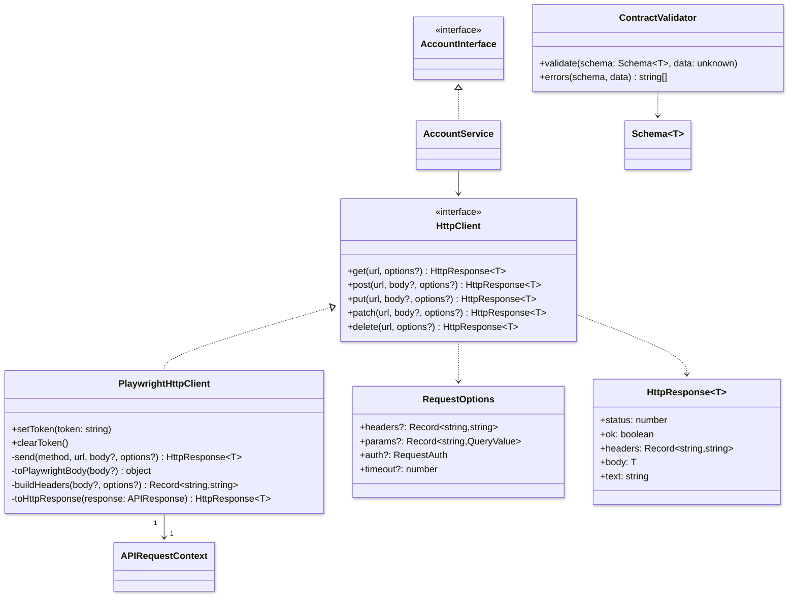

# HTTP Client Architecture

The following diagram shows the relationships between the core HTTP abstractions, a service and contract validation. Only `PlaywrightHttpClient` knows `APIRequestContext` (ADR-001).

